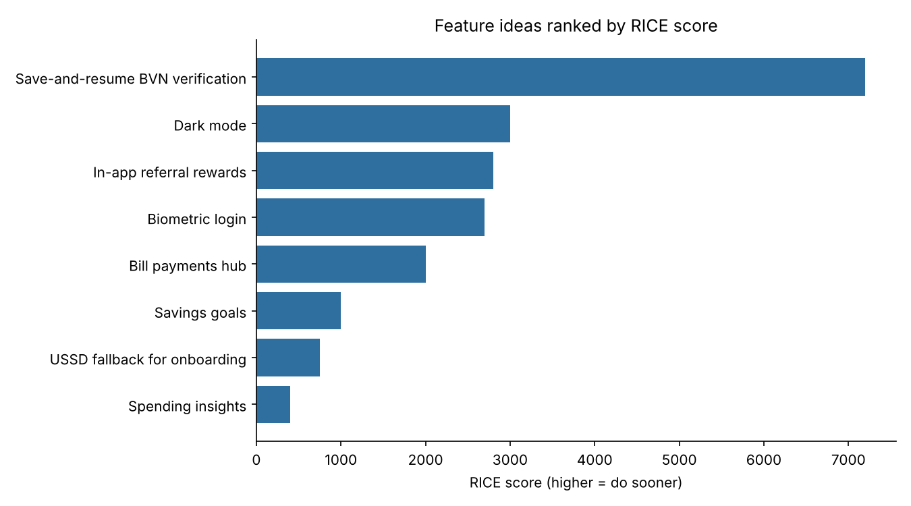

# Feature Prioritization for a Banking App using RICE

**Question:** A product team always has more ideas than capacity. How do you decide what to build first, and defend that decision to stakeholders?

This project scores eight hypothetical features for a retail mobile-banking app using the **RICE framework** and ranks them.

> The feature list and all scores are **hypothetical estimates I made up for illustration**. In a real team these would come from analytics, customer research and engineering input.

## The framework

**RICE score = (Reach x Impact x Confidence) / Effort**

| Factor | Meaning | Scale used |
|---|---|---|
| Reach | Customers affected per quarter | Number of customers |
| Impact | Effect on each customer who is reached | 0.25 minimal, 0.5 low, 1 medium, 2 high, 3 massive |
| Confidence | How sure are we of the estimates | 0 to 1 |
| Effort | Total work required | Person-months |

## Results

| Rank | Feature | RICE score |
|---|---|---|
| 1 | Save-and-resume BVN verification | 7,200 |
| 2 | Dark mode | 3,000 |
| 3 | In-app referral rewards | 2,800 |
| 4 | Biometric login | 2,700 |
| 5 | Bill payments hub | 2,000 |
| 6 | Savings goals | 1,000 |
| 7 | USSD fallback for onboarding | 750 |
| 8 | Spending insights | 400 |



## What I learned from the output

1. **The top item connects to real data.** Save-and-resume BVN verification ranks first because it targets the biggest drop-off in my [onboarding funnel analysis](https://github.com/hendiourenz/onboarding-funnel-analysis): high reach, high impact, modest effort.
2. **RICE rewards cheap, certain work.** Dark mode ranks second because its effort is tiny and confidence is 100%, even though its impact is minimal. A good PM treats this as a possible quick win, not as proof that dark mode matters more than referrals.
3. **RICE can undervalue big strategic bets.** The USSD fallback has the highest impact score (3) but ranks seventh because of its effort (6 person-months) and low confidence (0.5). It would reach customers the app currently cannot, so the right next step is a small experiment to raise confidence, not to delete the idea.
4. **The scores are only as good as the inputs.** Changing one confidence value can reorder the list, so the discussion about the numbers is as valuable as the final ranking.

## How to run

```bash
pip install pandas matplotlib
python src/rice.py      # reads data/features.csv, writes outputs/ranked_features.csv and rice_ranking.png
```

To use your own backlog, edit `data/features.csv` (columns: feature, description, reach, impact, confidence, effort).

## What this project demonstrates

Prioritization frameworks, trade-off thinking, and the judgment to question a framework's output instead of treating it as the answer.
